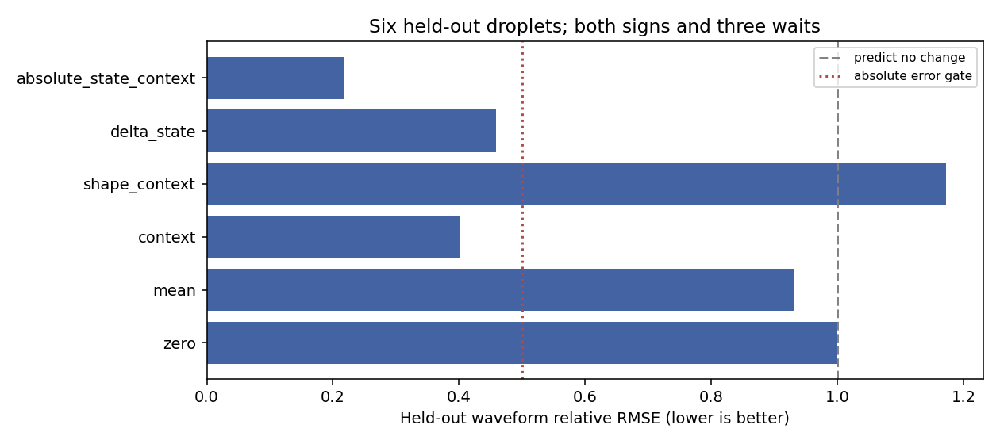

# Complexity

Can a field structure recover its shape while retaining a change that affects its next encounter?

This repository contains a headless simulator and bounded experiments on seeded field structures. Complex geometry is a valid research outcome; memory, causal control and useful computation require separate evidence.

## Start here

- [Research design and scientific gates](docs/superpowers/specs/2026-10-29-field-structure-memory-design.md)
- [Superpowers execution plan for Sol](docs/superpowers/plans/2026-10-29-field-structure-memory.md)

The recommended route is a small, headless 3D extraction of the numerical core of phi-world-theory/best.py. The first session builds a faithful solver and a bounded morphology atlas, then stops with a checkpoint. Later stages test recovery, changed probe response and state transfer only if earlier gates pass.

## Handoff (for Sol or anyone continuing)

Tasks 1–5 and the droplet campaign are done (see Current status below). Do **not** rerun them.
Continue from [HANDOFF.md](HANDOFF.md): it holds the latest checkpoint, reproduction commands, and the caveats to check first.

## Research ladder

1. Generate and describe geometry.
2. Establish persistence under the actual field dynamics.
3. Show recovery after a controlled encounter.
4. Test whether incremental response to a later probe changed.
5. Test which retained state carries that change.

A low-dimensional predictive object model and interactions between such objects are follow-up work, not assumed achievements.

## Current status (29 Oct 2026)

**Latest: internal state improves prediction on held-out droplets.** Five configurations train the models;
six configurations are held out entirely. Amplitude change and relative phase alone do **not** beat the context
baseline (relative waveform error 0.458 vs 0.402). Adding the reference oscillator's cosine/sine state and their
changes to context reduces error to **0.218**, meeting the frozen screen on 5/6 held-out droplets. This predicts
a particular local probe response, not the whole world's future. See the
[protocol](docs/superpowers/plans/2026-10-29-compact-predictive-state.md),
[receipt](results/predictive/summary.json), and [interpretation](RESULTS.md#compact-predictive-state-follow-up).

**Yes, for seeded droplets (11/11 tested).** A seeded cold droplet in best.py's rule recovers its shape after a kick but keeps a
changed internal breathing amplitude. That makes a later probe respond differently, and only the droplet's
interior carries the change. Full ledger: [RESULTS.md](RESULTS.md). Next step: [HANDOFF.md](HANDOFF.md).

* The solver reproduces best.py's rule exactly (tested against a line-by-line transcription).
* The voxel "crystal" mosaic behaves like a hot lattice gas. **The recorded kinetic-energy proxy rises over the tested interval**
  (0.66 → 2.73 over 4000 steps at tension 5; the tension-0 control does not show that heating). This does not establish unbounded growth or exclude every possible energy functional. The generic atlas screen found no
  compact object (0/6), because the positive phase percolates.
* The seeded bubble survives as a **cold droplet** (radius ~9, 100–900× colder) for ~3000 steps at tension 5,
  insulated by "amplitude slows propagation".
* Kick it (float64, write strength 0.2): shape recovers (IoU ≥ 0.94), and a later probe responds 5.7–17% differently;
  the same kick in the gas changes the droplet's response by ≤ 1e-8. Transplanting the droplet interior carries the
  whole effect; transplanting everything else carries none. The retained variable is the **breathing amplitude**
  (ω ≈ √2), whose anharmonic frequency shift makes the phase drift.
* Across 11 different droplets (sizes, tensions 3/5/8, grids 32/40) every one recovers its shape and keeps the
  effect (E = 0.04–0.07); the retained breathing amplitude is nearly universal (ΔA ≈ ±0.045).
* Caveats: at the spec's write strength 0.02 the effect is only 0.5%; the detector and strength were chosen after
  exploration and frozen before confirmation; droplets are seeded, finite-lifetime, and centred.

